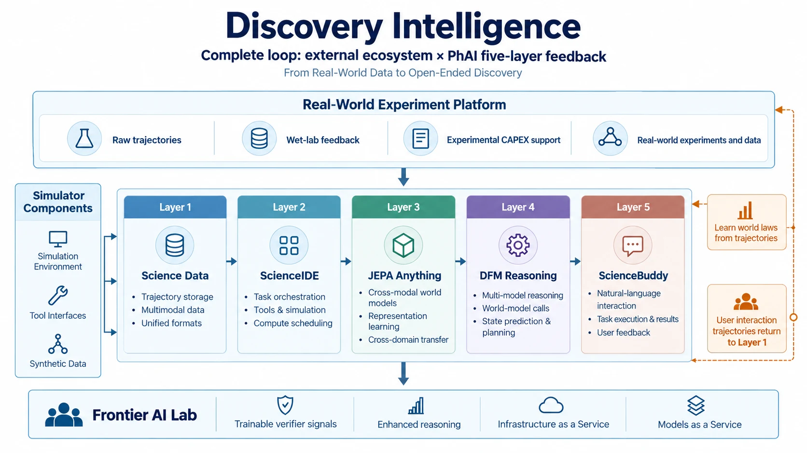
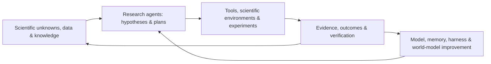
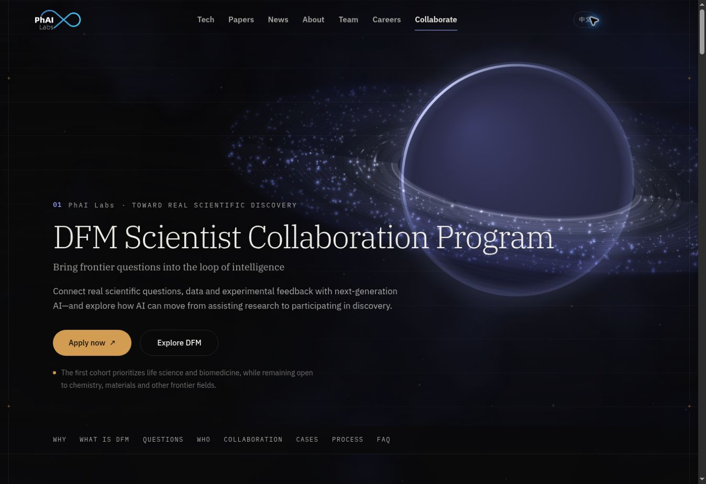

# Discovery Foundation Models

### Discovery Intelligence · Research & Open Source

**English** · [中文](README_CN.md) · [Website](https://phai-labs.com/) · [Technical Report](https://arxiv.org/abs/2609.15973) · [Research Progress](#research-progress) · [Scientist Collaboration](https://phai-labs.com/en/collaborate/)

**From answering questions and executing tasks to discovering what comes next.**

Discovery Foundation Models (DFMs) explore how AI can identify valuable unknowns, formulate problems, construct representations and hypotheses, gather external evidence, and improve its ability to discover across tasks.

Initiated by **[PhAI Labs](https://phai-labs.com/)**, this repository brings together the DFM technical report, research map, project announcements, and links to open research. **Individual research projects will be developed and released in their own repositories.** DFM-Plans maintains the overview, milestones, and navigation to those projects.

<p align="center">
  
</p>

*Discovery Intelligence architecture: external experiments, five-layer collaboration, and a closed feedback loop.*

## Technical Report

**[Discovery Foundation Models: Toward Open-Ended Discovery Intelligence](https://arxiv.org/abs/2609.15973)** — Technical Report.

The report organizes seven core capabilities: **Problem Discovery, Problem Formulation, Representation Construction, Hypothesis Formation, Intervention & Experimentation, Evidence-Grounded Revision, and Continual Discovery Improvement**.

Its reference architecture, **Zetema**, explores how explicit research states, memory, tools, experimental environments, verification, and human oversight can support a recursive discovery loop. It is a research design; implementation and validation progress will be reported through the linked projects.

## Research Progress

**Our research thesis.** Discovery Intelligence is not simply a scientific chatbot or another fixed benchmark. Math and coding advanced agent learning through executable tasks and relatively clear feedback; scientific research extends this frontier to **long-horizon, weakly verifiable, intervention-driven, and open-ended problems**. A DFM must not only solve tasks inside a fixed problem space, but also formulate valuable new questions and revise its assumptions using external evidence.

### The discovery and learning loop



The goal is to **turn research experience into a renewable source of learning**: new problems, failed attempts, experimental outcomes, and verified revisions change which tasks agents encounter next and how they solve them. The diagram is a **research-level map**, not a claim that all released projects already form one deployed stack.

### Research map: complementary projects, one agenda

| Research layer | Public project | Role in the DFM program | Availability & links |
| --- | --- | --- | --- |
| **Scientific interaction & agent learning** | **[ScienceBuddy](sciencebuddy/README.md)** | Researcher-facing scientific workflows; nested self-improvement of the agent harness (inner loop) and policy model (outer loop) | Released · 2026-09-16 · [Paper](https://arxiv.org/abs/2609.17523) · [Code](https://github.com/Gen-Verse/ScienceBuddy) · [Workspace](https://science-buddy.io/) |
| **Executable scientific environments** | **[ScienceIDE](scienceide/README.md)** | Compile scientific code and acceptance criteria into reusable, verifiable tasks for agent interaction and learning | Released · 2026-09-17 · [Paper](https://arxiv.org/abs/2609.19134) · [Code](https://github.com/aitofound/ScienceIDE) · [Models](https://huggingface.co/collections/AItonomy/scienceide-model-series) |
| **Training, execution & verification infrastructure** | **[ScienceInfra](https://github.com/Gen-Verse/ScienceInfra)** | Connect task banks, containerized execution, verifiers, online RL and independent evaluation | Ongoing open infrastructure · [Code & roadmap](https://github.com/Gen-Verse/ScienceInfra) |
| **Generalizable predictive world models** | **[JEPA-Anything](jepa-anything/README.md)** | Orthogonal Predictive Factorization (OPF) for predictive representations and state changes across heterogeneous worlds | Released · 2026-09-18 · [Paper](https://arxiv.org/abs/2609.20800) · [Code](https://github.com/Gen-Verse/JEPA-Anything) |
| **World-model-guided recursive improvement** | **[RSI-Anything](rsi-anything/README.md)** | Use predictions to guide action selection; use real feedback to update and validate policies, world models and workflows | Released · 2026-10 · [Paper](https://arxiv.org/abs/2610.13912) · [Code](https://github.com/Gen-Verse/RSI-Anything) |
| **Long-horizon agent memory & harnesses** | **[Recuris](recuris/README.md)** | Improve frozen agents through targeted, validated evolution of experiential and working memory | Released · 2026-08 · [Paper](https://arxiv.org/abs/2608.24876) · [Code](https://github.com/Gen-Verse/Recuris) |

**How they relate.** ScienceIDE expands the supply of executable research environments; ScienceInfra turns verifiable interaction into reproducible training and evaluation. ScienceBuddy studies the research-agent interface and joint harness/model learning. JEPA-Anything provides a cross-domain predictive foundation, which RSI-Anything extends into prediction-guided action and recursive improvement. Recuris investigates a complementary, training-free path: persistent memory and harness evolution for long tasks. **These are independently developed and evaluated research releases, not interchangeable components or a claimed end-to-end DFM implementation.**

### Evidence from released work

| Work | Selected reported evidence | What it demonstrates |
| --- | --- | --- |
| [ScienceBuddy](https://arxiv.org/abs/2609.17523) | On 180 held-out scientific questions, Qwen3.5-4B pass@4 increased from **48.3% to 67.8%** at the same four-attempt budget | Model learning and harness refinement can reinforce one another |
| [ScienceIDE](https://github.com/aitofound/ScienceIDE) | **64** environments in the study, **15** released with runtimes; PhAI-IDE **4B / 9B / 72B** model series | Scientific software can be converted into reusable execution and evaluation environments |
| [JEPA-Anything](https://arxiv.org/abs/2609.20800) | A predictive learning principle studied across **seven domains**, from vision and biology to physical fields and weather | Shared prediction interfaces can extend beyond a single environment type |
| [RSI-Anything](https://github.com/Gen-Verse/RSI-Anything) | Code-repair success **26.3% → 31.2%** from a static-verifier baseline to feedback-adapted world-model selection; **18.4% relative** improvement on OSWorld over the initial agent | Predictive models can help decide which actions and feedback to prioritize |
| [Recuris](https://github.com/Gen-Verse/Recuris) | Improvements in **35 of 37** completed model–benchmark pairs | Validated memory evolution can improve long-horizon agents without weight updates |

*Results are reported in their respective papers or repositories, on different tasks and protocols. They should not be read as a direct cross-project leaderboard.*

### Open research agenda

1. **From hypothesis generation to valuable problem discovery.** Represent hypotheses, research decisions, evidence and failed attempts as reusable experience; measure scientific value and research progress beyond execution success.
2. **Data–Environment–Verifier–Policy–Harness co-evolution.** Let newly exposed failure modes and experimental outcomes reshape the training distribution, environments, reward criteria, models and agent procedures.
3. **Long-horizon, weakly verifiable research.** Expand from short executable tasks toward multi-step investigations with delayed, partial or costly feedback.
4. **Prediction connected to intervention.** Improve world-model reliability under changing policies and connect computational proposals to reproducible simulations and, where feasible, real experiments.

The [DFM technical report](https://arxiv.org/abs/2609.15973) and Zetema architecture define the broader research direction. Public implementation and empirical claims remain scoped to the linked projects; ongoing directions above are **research goals**, not completed results.

## Scientist Collaboration

<p align="center">
  <a href="https://phai-labs.com/en/collaborate/">
    
  </a>
</p>

We welcome scientists, research teams, and experimental platforms with important open questions, scientific data, executable environments, or opportunities for real-world validation.

- **[Apply to the DFM Scientist Collaboration Program](https://ecnxosgyafi8.feishu.cn/wiki/Z1A2wr23ViqAOBkq3xfcgfl7nZg?table=tblboSz1SkRQ0iM2&view=vewoiUIlNk)**
- **[DFM Scientist Collaboration Program — Overview](https://phai-labs.com/en/collaborate/)**

## Developer Navigation & Index Updates

- Follow each project's repository for code, installation, technical questions, issues, and contributions.
- Use [Issues in this repository](https://github.com/Gen-Verse/DFM-Plans/issues) to suggest a project for inclusion, correct a link, or discuss the overall research map.
- Read [CONTRIBUTING.md](CONTRIBUTING.md) to submit an index or milestone update.

## Citation & Contact

If you find this work useful, please cite the DFM technical report. When using an individual project, please also cite its associated paper.

```bibtex
@article{yang2026discovery,
  title={Discovery Foundation Models: Toward Open-Ended Discovery Intelligence},
  author={Yang, Ling and Yin, Zhenfei and Wu, Yingcheng},
  journal={arXiv preprint arXiv:2609.15973},
  year={2026}
}

@article{xue2026sciencebuddy,
  title={ScienceBuddy: Recursive-in-Recursive Self-Improvement for Interactive Scientific Agents},
  author={Xue, Shuhan and Zhong, Jianyuan and Nan, Ziyuan and Li, Wenbin and Yu, Zhaochen and Ding, Jinchao and Gao, Qiang and Zhan, Pengyu and Zhang, Yuntong and Cheng, Tian and Yin, Zhenfei and Wu, Yingcheng and Yang, Ling},
  journal={arXiv preprint arXiv:2609.17523},
  year={2026}
}

@article{geng2026scienceide,
  title={ScienceIDE: Turning World's Scientific Codebase into Agent Learnable Environments},
  author={Geng, Hejia and Huang, Zesen and Li, Haoyang and Li, Wenbin and Wu, Koutian and Zhou, Zihan and Pang, Yuanbo and Liu, Weihao and Xu, Zigong and Li, Zhiping and Zhang, Zongzheng and Dong, Chuanfei and Sun, Jiankai and Zheng, Tianzhe and Xie, Fengyu and Ma, Yue and Shi, Yueheng and Xie, Tong and Di, Zonglin and Liu, Xianrong and Gao, Qucheng and Liu, Yimin and Pan, Jiaming and Huang, Sheng and Ma, Xiao-Han and Yuan, Lanqing and Zhu, Zhenlin and Liu, Ziang and Xu, Ziyang and Wang, Junkai and Liang, Kangkai and Xian, Jiayi and Zhao, Zehong and Xu, Liuwei and Xie, Jingxu and Zhang, Peijin and Gao, Qiang and Xing, Chengyi and Zhao, Zhe and Wang, Xi and Xing, Yaopeng and Meng, Xing and Yin, Zhenfei and Wu, Yingcheng and Yang, Ling},
  journal={arXiv preprint arXiv:2609.19134},
  year={2026}
}

@article{cui2026jepaanything,
  title={JEPA-Anything: Learning Predictive Models across Different Worlds},
  author={Cui, Taoyong and Wang, Zhongyao and Xu, Xinyue and Liu, Weiyang and Yu, Zhaochen and Zhang, Yuying and Gao, Qiang and Yang, Mengyue and Ouyang, Wanli and Heng, Pheng Ann and Wu, Yingcheng and Yin, Zhenfei and Yang, Ling},
  journal={arXiv preprint arXiv:2609.20800},
  year={2026}
}

@misc{cui2026rsianything,
  title={RSI-Anything: Unlocking Recursive Self-Improvement with World Models},
  author={Cui, Taoyong and Zeng, Pinxian and Xu, Wanghan and Xiao, Hao and Xue, Shuhan and Gao, Qiang and Ouyang, Wanli and Heng, Pheng Ann and Yin, Zhenfei and Wu, Yingcheng and Yang, Ling},
  year={2026},
  eprint={2610.13912},
  archivePrefix={arXiv},
  url={https://arxiv.org/abs/2610.13912}
}

@article{yu2026recuris,
  title={Recursive Experiential--Working Memory Evolution for Long-Horizon Agent Harnesses},
  author={Yu, Zhaochen and Wu, Yingcheng and Yin, Zhenfei and Chen, Kaiyuan and Zhao, Zhe and Wang, Mengdi and Yan, Shuicheng and Yang, Ling},
  journal={arXiv preprint arXiv:2608.24876},
  year={2026}
}

```

**PhAI Labs** · [Website](https://phai-labs.com/) · [yang@phai-labs.com](mailto:yang@phai-labs.com)
