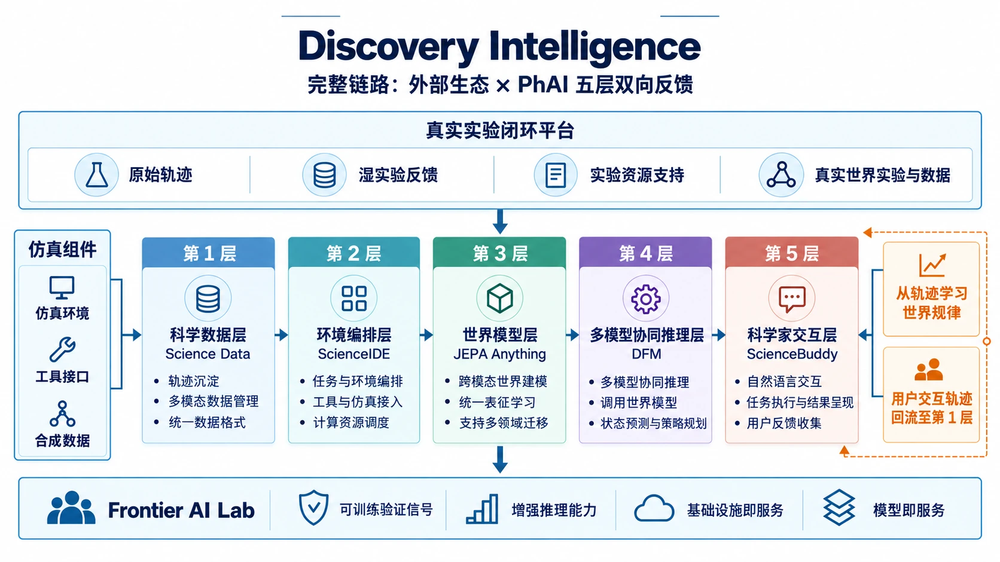
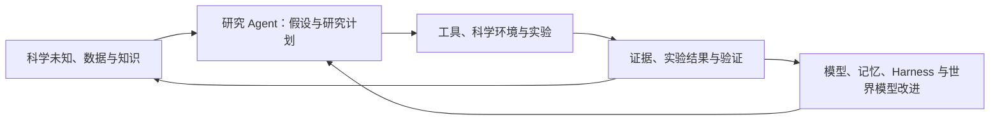
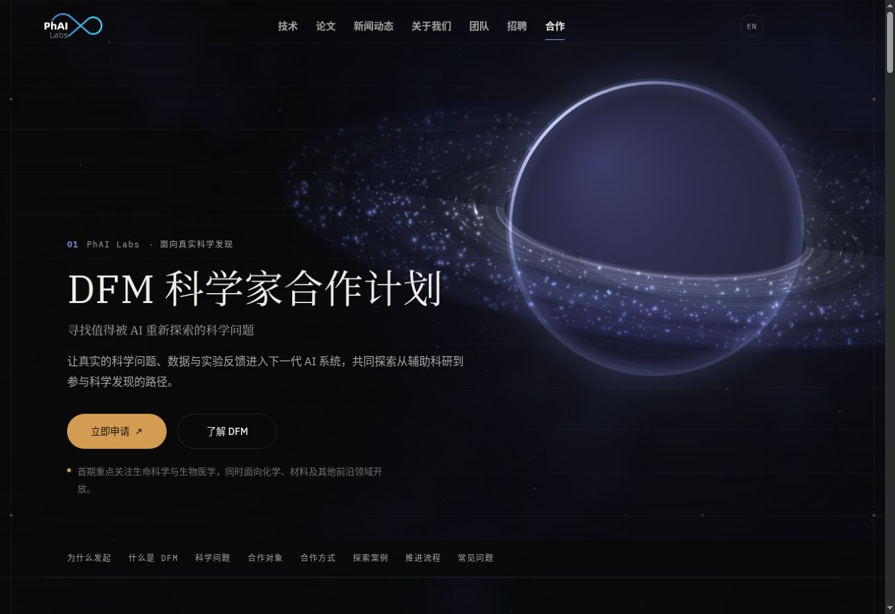

# Discovery Foundation Models

### 发现智能 · 研究与开源

[English](README.md) · **中文** · [官方网站](https://phai-labs.com/) · [技术报告](https://arxiv.org/abs/2609.15973) · [研究项目与进展](#研究项目与进展) · [科学家合作计划](https://phai-labs.com/collaborate/)

**从回答问题、执行任务，走向发现有价值的未知。**

Discovery Foundation Models（DFMs）探索 AI 如何发现问题、形成可研究的问题、构造科学表征与假设、获取外部证据，并在不同任务中持续提升发现能力。

本仓库由 **[PhAI Labs](https://phai-labs.com/)** 发起，汇总 DFM 技术报告、研究版图、成果介绍与开放研究入口。**各项研究工作将在独立 GitHub 仓库中开发和发布；DFM-Plans 负责汇总、里程碑更新与项目导航。**

<p align="center">
  
</p>

*发现智能架构：连接外部实验、五层协同与闭环反馈。*

## 技术报告

**[Discovery Foundation Models: Toward Open-Ended Discovery Intelligence](https://arxiv.org/abs/2609.15973)** — 技术报告。

报告提出七项核心能力：**问题发现、问题形成、表征构造、假设形成、干预与实验、证据驱动的修正，以及跨任务的持续发现能力提升。**

参考架构 **Zetema** 探索如何通过显式研究状态、记忆、科学工具、实验环境、验证机制和人类监督，组织递归发现循环。它是一套研究设计；具体实现与验证进展将通过各项独立研究持续更新。

## 研究项目与进展

**核心研究主张。** Discovery Intelligence 不只是科学问答产品，也不只是增加一个固定的科学 Benchmark。Math 与 Coding 依靠可执行任务和相对清晰的反馈推动了 Agent 学习；科学研究进一步引入**长程、弱可验证、需要真实干预且开放式的问题**。DFM 不仅要在给定问题空间里搜索答案，还需要发现有价值的问题，并依靠外部证据修正问题、假设与研究路径。

### 从科学问题到持续学习的闭环



我们的目标是**将研究过程转化为可持续积累的学习经验**：新问题、失败轨迹、实验结果和经过验证的修正，不断改变模型下一轮遇到的任务分布与解决问题的方法。这是**研究层面的体系图**，并不意味着各个独立开源项目已经集成为同一套完整产品。

### 研究版图：各有分工，形成闭环

| 研究层次 | 已公开项目 | 在 DFM 体系中的作用 | 状态与入口 |
| --- | --- | --- | --- |
| **科学家交互与 Agent 学习** | **[ScienceBuddy](sciencebuddy/README_CN.md)** | 面向研究者的科学工作流；内环改进 Agent Harness，外环训练模型 | 已发布 · 2026-09-16 · [论文](https://arxiv.org/abs/2609.17523) · [代码](https://github.com/Gen-Verse/ScienceBuddy) · [产品](https://science-buddy.io/) |
| **可执行科学环境** | **[ScienceIDE](scienceide/README_CN.md)** | 将科学代码与验收标准转化为可执行、可验证的训练与评测任务 | 已发布 · 2026-09-17 · [论文](https://arxiv.org/abs/2609.19134) · [代码](https://github.com/aitofound/ScienceIDE) · [模型](https://huggingface.co/collections/AItonomy/scienceide-model-series) |
| **训练、执行与验证基础设施** | **[ScienceInfra](https://github.com/Gen-Verse/ScienceInfra)** | 串联任务库、容器化执行、Verifier、在线 RL 与独立评测 | 持续开源建设 · [代码与路线图](https://github.com/Gen-Verse/ScienceInfra) |
| **跨领域预测世界模型** | **[JEPA-Anything](jepa-anything/README_CN.md)** | 以 OPF 正交预测分解学习不同领域的状态表征和变化规律 | 已发布 · 2026-09-18 · [论文](https://arxiv.org/abs/2609.20800) · [代码](https://github.com/Gen-Verse/JEPA-Anything) |
| **世界模型驱动的递归改进** | **[RSI-Anything](rsi-anything/README_CN.md)** | 用预测选择行动，利用真实反馈更新与验证 Policy、World Model 和研究流程 | 已发布 · 2026-10 · [论文](https://arxiv.org/abs/2610.13912) · [代码](https://github.com/Gen-Verse/RSI-Anything) |
| **长程 Agent 的记忆与 Harness** | **[Recuris](recuris/README_CN.md)** | 通过局部、可验证的经验记忆与工作记忆演化改进冻结的 Agent | 已发布 · 2026-08 · [论文](https://arxiv.org/abs/2608.24876) · [代码](https://github.com/Gen-Verse/Recuris) |

**这些工作如何连接？** ScienceIDE 提供新的可执行科学任务，ScienceInfra 将任务执行与可验证反馈转化为训练及评测流程；ScienceBuddy 探索真实研究交互以及 Harness/模型协同改进；JEPA-Anything 为跨领域状态预测提供方法基础，RSI-Anything 在此基础上连接行动、预测、外部反馈和持续改进；Recuris 则探索另一条无需更新模型权重的长程记忆演化路径。**上述工作各自独立开发与评估，不能直接视为已经集成部署的完整 DFM 系统。**

### 已发布工作的代表性结果

| 工作 | 公开报告的结果 | 对研究体系的意义 |
| --- | --- | --- |
| [ScienceBuddy](https://arxiv.org/abs/2609.17523) | 180 道留出科学问题上，Qwen3.5-4B 在相同四次尝试预算下 pass@4 由 **48.3% 提高至 67.8%** | Harness 优化和模型训练能够形成相互促进的学习机制 |
| [ScienceIDE](https://github.com/aitofound/ScienceIDE) | 研究涉及 **64** 个科学环境，其中 **15** 个已公开运行环境；发布 PhAI-IDE **4B / 9B / 72B** 系列 | 科学代码可转化为可复用的执行、验证与评测环境 |
| [JEPA-Anything](https://arxiv.org/abs/2609.20800) | 在视觉、生物、临床、控制、分子动力学、物理场和天气等 **七类领域**研究统一预测机制 | 世界模型可以跨越单一任务类型，提供共同预测接口 |
| [RSI-Anything](https://github.com/Gen-Verse/RSI-Anything) | 代码修复从静态验证基线 **26.3% 提升至 31.2%**；OSWorld 相对初始 Agent 提升 **18.4%** | 将预测用于行动选择，并通过反馈提升后续决策 |
| [Recuris](https://github.com/Gen-Verse/Recuris) | 完成评估的 **37** 组模型—Benchmark 组合中有 **35** 组提升 | 不更新模型权重，也可依靠可验证的记忆演化提升长程任务表现 |

*上述结果来自各项目论文或仓库，评测任务和实验设置不同，不构成项目间的横向排行榜。*

### 下一阶段研究重点

1. **从提出假设到发现有价值的新问题。** 将假设演化中的关键决策、证据、失败尝试和修正转化为可复用 Experience，分别评估假设质量、研究进展与可执行性。
2. **Data–Environment–Verifier–Policy–Harness 协同演化。** 根据新任务、失败模式与实验结果，动态改进训练分布、环境、验证标准、模型与 Agent 工作流程。
3. **面向长程、弱可验证研究任务的学习。** 从短程代码任务扩展到反馈延迟、验证昂贵、涉及多阶段调查的科学问题。
4. **从世界模型预测走向真实干预。** 在 Policy 不断变化时持续校验预测可靠性，并将计算任务连接到可复现实验、模拟以及具备条件的真实实验。

[DFM 技术报告](https://arxiv.org/abs/2609.15973)与 Zetema 参考架构定义长期方向。具体公开实现和实验结论以独立项目为准；上述后续方向属于**研究计划**，而非已完成的成果。

## 科学家合作计划

<p align="center">
  <a href="https://phai-labs.com/collaborate/">
    
  </a>
</p>

欢迎拥有重要开放问题、专业数据、可执行环境或真实实验验证条件的科学家、研究团队与实验平台参与合作。

- **[申请加入 DFM 科学家合作计划](https://ecnxosgyafi8.feishu.cn/wiki/Z1A2wr23ViqAOBkq3xfcgfl7nZg?table=tblboSz1SkRQ0iM2&view=vewoiUIlNk)**
- **[DFM 科学家合作计划介绍](https://phai-labs.com/collaborate/)**

## 开发者导航与索引维护

- 代码、安装说明、技术问题、Issue 与贡献方式，请前往对应项目的独立仓库。
- 如需推荐收录项目、纠正链接或讨论整体研究版图，请使用[本仓库 Issues](https://github.com/Gen-Verse/DFM-Plans/issues)。
- 提交索引或里程碑更新，请参阅 [贡献指南](CONTRIBUTING_CN.md)。

## 引用与联系

如果本研究对你有帮助，请引用 DFM 技术报告；使用具体项目时，也请引用相应项目论文。

```bibtex
@article{yang2026discovery,
  title={Discovery Foundation Models: Toward Open-Ended Discovery Intelligence},
  author={Yang, Ling and Yin, Zhenfei and Wu, Yingcheng},
  journal={arXiv preprint arXiv:2609.15973},
  year={2026}
}

@article{xue2026sciencebuddy,
  title={ScienceBuddy: Recursive-in-Recursive Self-Improvement for Interactive Scientific Agents},
  author={Xue, Shuhan and Zhong, Jianyuan and Nan, Ziyuan and Li, Wenbin and Yu, Zhaochen and Ding, Jinchao and Gao, Qiang and Zhan, Pengyu and Zhang, Yuntong and Cheng, Tian and Yin, Zhenfei and Wu, Yingcheng and Yang, Ling},
  journal={arXiv preprint arXiv:2609.17523},
  year={2026}
}

@article{geng2026scienceide,
  title={ScienceIDE: Turning World's Scientific Codebase into Agent Learnable Environments},
  author={Geng, Hejia and Huang, Zesen and Li, Haoyang and Li, Wenbin and Wu, Koutian and Zhou, Zihan and Pang, Yuanbo and Liu, Weihao and Xu, Zigong and Li, Zhiping and Zhang, Zongzheng and Dong, Chuanfei and Sun, Jiankai and Zheng, Tianzhe and Xie, Fengyu and Ma, Yue and Shi, Yueheng and Xie, Tong and Di, Zonglin and Liu, Xianrong and Gao, Qucheng and Liu, Yimin and Pan, Jiaming and Huang, Sheng and Ma, Xiao-Han and Yuan, Lanqing and Zhu, Zhenlin and Liu, Ziang and Xu, Ziyang and Wang, Junkai and Liang, Kangkai and Xian, Jiayi and Zhao, Zehong and Xu, Liuwei and Xie, Jingxu and Zhang, Peijin and Gao, Qiang and Xing, Chengyi and Zhao, Zhe and Wang, Xi and Xing, Yaopeng and Meng, Xing and Yin, Zhenfei and Wu, Yingcheng and Yang, Ling},
  journal={arXiv preprint arXiv:2609.19134},
  year={2026}
}

@article{cui2026jepaanything,
  title={JEPA-Anything: Learning Predictive Models across Different Worlds},
  author={Cui, Taoyong and Wang, Zhongyao and Xu, Xinyue and Liu, Weiyang and Yu, Zhaochen and Zhang, Yuying and Gao, Qiang and Yang, Mengyue and Ouyang, Wanli and Heng, Pheng Ann and Wu, Yingcheng and Yin, Zhenfei and Yang, Ling},
  journal={arXiv preprint arXiv:2609.20800},
  year={2026}
}

@misc{cui2026rsianything,
  title={RSI-Anything: Unlocking Recursive Self-Improvement with World Models},
  author={Cui, Taoyong and Zeng, Pinxian and Xu, Wanghan and Xiao, Hao and Xue, Shuhan and Gao, Qiang and Ouyang, Wanli and Heng, Pheng Ann and Yin, Zhenfei and Wu, Yingcheng and Yang, Ling},
  year={2026},
  eprint={2610.13912},
  archivePrefix={arXiv},
  url={https://arxiv.org/abs/2610.13912}
}

@article{yu2026recuris,
  title={Recursive Experiential--Working Memory Evolution for Long-Horizon Agent Harnesses},
  author={Yu, Zhaochen and Wu, Yingcheng and Yin, Zhenfei and Chen, Kaiyuan and Zhao, Zhe and Wang, Mengdi and Yan, Shuicheng and Yang, Ling},
  journal={arXiv preprint arXiv:2608.24876},
  year={2026}
}

```

**PhAI Labs** · [官方网站](https://phai-labs.com/) · [yang@phai-labs.com](mailto:yang@phai-labs.com)
